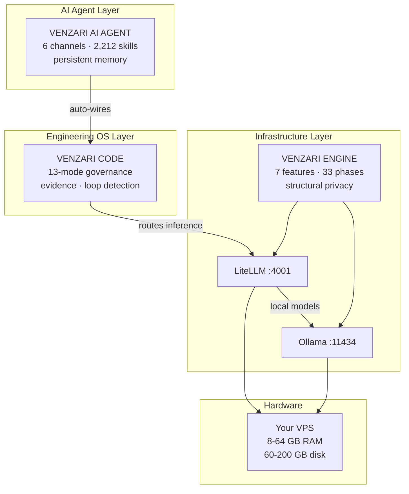

<div align="center">
  <pre align="center" style="color:#3251fc;background:#0d0d0d;padding:16px;border-radius:8px;font-size:12px">
██╗   ██╗███████╗███╗   ██╗███████╗ █████╗ ██████╗ ██╗
██║   ██║██╔════╝████╗  ██║╚══███╔╝██╔══██╗██╔══██╗██║
██║   ██║█████╗  ██╔██╗ ██║  ███╔╝ ███████║██████╔╝██║
╚██╗ ██╔╝██╔══╝  ██║╚██╗██║ ███╔╝  ██╔══██║██╔══██╗██║
 ╚████╔╝ ███████╗██║ ╚████║███████╗██║  ██║██║  ██║██║
  ╚═══╝  ╚══════╝╚═╝  ╚═══╝╚══════╝╚═╝  ╚═╝╚═╝  ╚═╝╚═╝
  </pre>

  <h1 style="font-family:'Unbounded',sans-serif;font-size:clamp(3rem,8vw,5rem);font-weight:800;color:#FDFBF9;letter-spacing:-0.02em;margin:1rem 0;">
    VENZARI
  </h1>
  <p style="font-family:'Poppins',sans-serif;font-size:1.25rem;color:rgba(253,251,249,.6);line-height:1.6;max-width:600px;margin:0 auto 2rem;">
    Private AI infrastructure · Engineering OS · Persistent autonomous agent
  </p>

  <p>
    <a href="https://venzari.co/code"></a>
    <a href="https://venzari.co/engine"></a>
    <a href="https://venzari.co/products/venzari-ai-agent"></a>
    <a href="https://venzari.co/together"></a>
    <a href="https://venzari.co/enterprise"></a>
  </p>
  <p>
    <a href="https://venzari.co"></a>
    <a href="https://install.venzari.xyz"></a>
    <a href="https://docs.venzari.co"></a>
    <a href="https://discord.gg/venzari"></a>
  </p>
</div>

---

## 01 — Problem

```yaml
problem:
  current_state: "AI infrastructure is rented, not owned"
  symptoms:
    - "Data leaves your control on every API call"
    - "Per-token billing has no ceiling"
    - "AI forgets you between sessions"
    - "No governance layer for AI-assisted development"
    - "Enterprise AI costs $50,000+/year with 6-month implementation"
  consequence: "Companies that need AI for sensitive work cannot use cloud AI for it"
```

## 02 — Architecture



No cloud calls for inference when the stack is active. All components run on your hardware.

## 03 — VENZARI CODE

```yaml
product: VENZARI CODE
category: Engineering OS
version: 1.0.0
status: LIVE
install: "curl -fsSL https://install.venzari.xyz | bash && venzari-code install"
url: https://venzari.co/code
tests: 1508
test_files: 74
```

### 03.1 — The 13 Modes

| # | Mode | Scope | Writes | Executes | Evidence |
|---|------|-------|--------|----------|---------|
| 1 | Discover | Observation only | ✗ | ✗ | Observational report |
| 2 | Plan | Planning only | ✗ | ✗ | Plan document |
| 3 | Implement | Approved scope only | ✓ | ✓ (scoped) | Working code |
| 4 | Validate | Test execution | ✗ | ✓ | **Actual test output** |
| 5 | Review | Read-only analysis | ✗ | ✗ | Review report |
| 6 | Repair | Fix-only, scope locked | ✓ | ✓ (scoped) | Fix diff |
| 7 | Commit | Git operations only | Git | ✗ | Structured commit + evidence |
| 8 | Advisor | Analysis only | ✗ | ✗ | Analysis document |
| 9 | Handoff | Session end | ✗ | ✗ | Handoff document |
| 10 | Audit | Evidence review | ✗ | ✗ | Audit report |
| 11 | Benchmark | Performance testing | ✗ | ✓ | Benchmark data |
| 12 | Migration | Large-scale changes | ✓ | ✓ | Migration plan + execution |
| 13 | Release | Full access | ✓ | ✓ | Release evidence |

### 03.2 — Governance Components

```yaml
governance:
  ssot_loader:
    action: "Reads project rules before every action"
    result: "AI operates within established patterns"
  tool_guard:
    action: "Per-mode allowlists at system call level"
    result: "Mode restrictions enforced structurally, not by prompt"
  loop_detector:
    action: "Tracks action patterns, 3-strike escalation"
    result: "Runaway sessions stopped automatically"
  evidence_collector:
    action: "Logs every tool call: input, output, timestamp"
    result: "Immutable evidence chain follows every commit"
  context_assembler:
    action: "Constructs <4,000 char synthetic context window"
    result: "Relevant project knowledge without context overflow"
```

### 03.3 — Companion System

```
.venzari/
├── agents/      # Configured roles with constraints
├── skills/      # 24 native + 216 vendor task templates
├── tasks/       # Structured definitions with gates
├── rules/       # Project-specific constraints
├── memory/      # Session history, codegraph, decisions
└── gates/       # Closing checks before task completion
```

### 03.4 — Verified Metrics

| Metric | Value |
|--------|-------|
| Automated tests | 1,508 passing, 0 failing |
| Pre-install checks | 6 (RAM/Disk/git/Runtime/Existing/Internet) |
| MCP tools | 6 (doctor/list_tasks/get_logs/get_context/get_mode/run_automation) |
| Desktop app | Tauri v2 (.AppImage/.deb/.rpm) |
| JetBrains plugin | v0.2.2, 1.6 MB |
| Languages | 6 (en/es/fr/de/ja/pt) |
| Security CI | 4 jobs (dep-audit/secret-scan/license-check/SBOM) |
| Companion skills | 24 native + 216 vendor |

## 04 — VENZARI ENGINE

```yaml
product: VENZARI ENGINE
category: Private AI Infrastructure
version: 1.0.0
status: LIVE — ALL 33 PHASES COMPLETE
install: "curl -fsSL https://install.venzari.xyz/engine | sh"
url: https://venzari.co/engine
phases: 33
installer_tests: 2301
launch_date: 2026-09-05
```

### 04.1 — The 7 Features

| # | Feature | Live | Key capability |
|---|---------|------|---------------|
| 1 | Conversational AI + memory | ✓ | Permanent, private, cumulative understanding |
| 2 | Voice synthesis + recognition | ✓ | Offline TTS/STT, zero cloud audio |
| 3 | Workflow automation | ✓ | Reports, email, CRM, calendar — all local |
| 4 | Web dashboard | ✓ | Full UI at your domain |
| 5 | REST API | ✓ | Connect to ERP, CRM, HR — locally |
| 6 | Semantic memory search | ✓ | Natural language recall across all knowledge |
| 7 | Custom fine-tuning | ✓ (Growth+) | Train on your data, model runs locally |

### 04.2 — Structural Privacy

```yaml
privacy:
  type: structural
  mechanism: "Data physically cannot leave hardware by design"
  offline_operation: true
  vendor_access: "No mechanism exists for VENZARI to access installed data"
  comparison:
    cloud_ai:
      privacy: "policy document (can change)"
      data_location: "vendor's cloud"
      offline: false
    enterprise_platforms:
      privacy: "policy document (can change)"
      data_location: "vendor's cloud"
      offline: false
    venzari_engine:
      privacy: "architecture (cannot change without removing the product)"
      data_location: "your server"
      offline: true
```

### 04.3 — Installer: 3 Stages

**Stage 1 — 11 Pre-Install Checks:**

```bash
# Automatic, parallel — any failure stops and tells operator what to fix
[1] RAM check          → warn <16GB, fail <8GB
[2] Disk check         → warn <40GB, fail <60GB
[3] Port 4001 check    → fail if occupied
[4] Port 11434 check   → fail if occupied
[5] Port 5432 check    → fail if occupied
[6] Port 6379 check    → fail if occupied
[7] Docker check       → fail if not installed/running
[8] Internet check     → fail if no connectivity to installer.venzari.xyz
[9] Sudo check         → fail if not available
[10] Existing install  → detect and warn
[11] Architecture      → verify CPU architecture
```

**Stage 2 — 7-Question Wizard:**

```bash
[1] Server identity    → domain/IP, company name, admin email
[2] License key        → validate against keygen
[3] AI provider        → local-only / local+cloud / cloud-only
[4] Model selection    → hardware-adaptive recommendations
[5] Add-ons            → Growth+ features (optional)
[6] Configuration      → review and adjust
[7] Confirm            → begin installation
```

**Stage 3 — 17-Step Worker Plan:**

```bash
# Hardware profile → installer.venzari.xyz → customized 17-step plan
Step 1:  Pre-install verification (re-run checks)
Step 2:  Binary download (SHA256 verified, R2/Keygen)
Step 3:  Model pull — fast (hardware-adaptive)
Step 4:  Model pull — reasoning (hardware-adaptive)
Step 5:  Model pull — embedding
Step 6:  Docker-compose write
Step 7:  Service startup
Step 8:  Health check — gateway
Step 9:  Health check — memory
Step 10: Health check — voice
Step 11: Gateway configuration (probe all providers)
Step 12: SSL configuration (nginx + certbot)
Step 13: nginx setup
Step 14: Ecosystem wiring (detect CODE/AGENT)
Step 15: MCP registration
Step 16: Anonymous install ping
Step 17: Final health verification

# Resumable: venzari-engine install --repair
# 2,301 automated tests covering all steps
```

### 04.4 — Hardware Requirements

```yaml
minimum:
  cpu: "4 cores"
  ram: "8 GB (fails), 16 GB (comfortable)"
  storage: "60 GB SSD"
  gpu: "not required"
  os: "Ubuntu 22.04 LTS"
  network: "static IP recommended"

recommended:
  cpu: "16+ cores"
  ram: "32-64 GB"
  storage: "200+ GB NVMe"
  gpu: "NVIDIA ≥8 GB VRAM (5-15× faster inference)"
  os: "Ubuntu 22.04 LTS"
```

### 04.5 — 33 Phases Complete

```yaml
phases:
  "0-15": "Core AI stack, wizard, smart installer, LiteLLM, SSL, security, observability, launch"
  "8": "Resumable state machine, --repair, --reset"
  "10": "nginx, certbot, Caddy fallback, keepwarm"
  "12": "Custom training pipeline (export → train → import)"
  "13": "Security hardening, Authelia, backup, secret rotation"
  "14": "Prometheus + Grafana observability (Growth+)"
  "15": "Self-update: venzari-engine upgrade"
  "18": "Email lifecycle: 6 events × 6 locales"
  "19": "Clean uninstall: venzari-engine uninstall [--keep-data]"
  "21": "CLI i18n: 6 languages, 21 keys, --locale"
  "22": "Security CI: 0 vulns, 0 secrets, 0 GPL/AGPL, CycloneDX SBOM"
  "23": "Ecosystem: auto-detect CODE + AI AGENT"
  "24": "17-check pre-publish CI gate"
  "26": "Privacy-safe install ping telemetry"
  "28": "11-check pre-install environment checker"
  "29": "nginx SSL, gateway config, Gigapipe, sudo-prefix"
  "30": "MCP server: 16 tools"
  "32": "E2E smoke test: 15/15 full checks"
  "33": "v1.0.0 public launch — R2 artifacts, GitHub Release"
launch: "2026-09-05"
```

## 05 — VENZARI AI AGENT

```yaml
product: VENZARI AI AGENT
category: Persistent Autonomous Agent
version: 1.1.0
status: LIVE
install: "curl -fsSL https://install.venzari.xyz/agent | sh"
url: https://venzari.co/products/venzari-ai-agent
tests: 422
```

### 05.1 — 6 Live Channels

| Channel | Status | Protocol |
|---------|--------|----------|
| Telegram | ✅ LIVE | Bot API |
| Slack | ✅ LIVE | Slack Events API |
| Discord | ✅ LIVE | Gateway |
| Email | ✅ LIVE | Mailgun/Acelle |
| Web chat | ✅ LIVE | WebSocket widget |
| Webhook | ✅ LIVE | HTTP POST |

### 05.2 — 3-Signal Memory

```yaml
memory:
  vector_embeddings:
    method: "Semantic search"
    latency: 50ms
    use_case: "What did we discuss about billing?"
  bm25_fulltext:
    method: "Exact phrase match"
    latency: 10ms
    use_case: "Code snippets, exact terms"
  pagerank_graph:
    method: "Importance ranking"
    latency: 5ms
    use_case: "Most referenced memories surface first"
```

### 05.3 — 2,212 Skills

```yaml
skills:
  s_tier: 11    # flagship, highest reliability
  a_tier: 522   # high quality, broad coverage
  b_tier: 1679  # community catalog, wide reach
  total: 2212
  invocation: "automatic — no explicit skill selection needed"
  cli: "venzari-agent skills list | search | run"
```

### 05.4 — 8-Provider Router

```yaml
router:
  providers:
    - name: "Local Ollama"
      cost: "free"
      privacy: "complete"
    - name: "Groq"
      cost: "free tier available"
      feature: "fast inference"
    - name: "Gemini"
      cost: "free tier available"
    - name: "OpenRouter"
      feature: "broad model access"
    - name: "Cerebras"
      feature: "ultra-fast inference"
    - name: "Anthropic"
      feature: "Claude models"
    - name: "OpenAI"
      feature: "GPT models"
    - name: "Bedrock"
      feature: "AWS enterprise"
  circuit_breaker:
    threshold: 3    # failures → bypass
    recovery: "auto after cooldown"
  budget_monitor:
    downgrade_at: "80% of session budget"
  engine_integration:
    behavior: "if ENGINE installed, all calls route through LiteLLM :4001"
    config: "zero — auto-detected"
```

### 05.5 — Additional Components

| Component | Details |
|-----------|---------|
| CLI binary | `venzari-agent` — 15+ commands (start/stop/doctor/skills/memory/channels/upgrade) |
| Desktop app | Tauri v2, 5 tabs (Chat/Skills/Memory/Channels/Settings), system tray |
| Dashboard | 9 pages at agent.venzari.co (Overview/Chat/Skills/Memory/Tasks/Channels/Training/Evolution/Router) |
| MCP server | 12 tools (status/router/messages/conversations/memory/skills/evolution/channels) |
| Ecosystem | Auto-detects ENGINE + CODE, wires automatically |

## 06 — VENZARI Together

```yaml
product: VENZARI Together
version: 0.1.0
status: LIVE
install: "curl -fsSL https://install.venzari.xyz/together | sh"
url: https://venzari.co/together
```

```bash
# One command installs both CODE and ENGINE, wired together
curl -fsSL https://install.venzari.xyz/together | sh

# After install
venzari-together doctor    # check all services
venzari-together status    # combined status + model list
venzari-code "refactor this"  # CODE routes through local ENGINE
```

| Requirement | Minimum | Recommended |
|-------------|---------|-------------|
| RAM | 8 GB | 16 GB+ |
| Disk | 20 GB free | 50 GB+ |
| OS | Ubuntu 20.04+ | Ubuntu 22.04 LTS |
| GPU | Optional | NVIDIA 8 GB+ VRAM |

22-step hardware-aware install plan. No cloud inference when active.

## 07 — Comparison

### ENGINE vs Alternatives

| Dimension | Cloud AI APIs | DIY Stack | Enterprise Platforms | VENZARI ENGINE |
|-----------|-------------|-----------|---------------------|----------------|
| Setup time | Minutes | 3-6 months | 3-6 months | 20 minutes |
| Staff required | Developer | AI engineers | Implementation team | Office manager |
| Price/year | Variable (per-token) | Staff cost | $50,000+ | $4,188-$29,988 |
| Data location | Vendor cloud | Your server | Vendor cloud | Your server |
| Privacy | Policy | DIY | Policy | Architecture |
| Memory | Session | DIY | Varies | Permanent |
| Testing | N/A | Ad hoc | Varies | 2,301 tests |
| Updates | Auto | Manual | Vendor-managed | `venzari-engine upgrade` |

### CODE vs Alternatives

| Dimension | Copilot/Cursor | Agent Frameworks | VENZARI CODE |
|-----------|----------------|-----------------|-------------|
| Category | Tool | Building block | Operating System |
| Memory | Session | None | Permanent, project-scoped |
| Governance | None | None | 13-mode lifecycle |
| Evidence | None | None | Required per completion |
| Loop detection | None | None | 3-strike escalation |
| Self-improvement | None | None | Correction-based learning |
| Enterprise-ready | No | No | Yes |
| Audit trail | None | None | Full evidence chain |
| Multi-agent | None | Manual | SubagentPool + DAG |

### AI AGENT vs Alternatives

| Dimension | ChatGPT/Claude | Pi/Character.AI | Enterprise Platforms | VENZARI AI AGENT |
|-----------|----------------|----------------|---------------------|-----------------|
| Memory | Session | Session | Varies | Permanent, 3-signal |
| Channels | 1 | 1 | Varies | 6 live |
| Learning | None | None | None | Nightly skill creation |
| Skills | Implicit | None | Custom ($$$) | 2,212 built-in |
| CLI | No | No | No | Yes (15+ commands) |
| Desktop app | No | No | No | Yes (Tauri v2) |
| MCP server | No | No | No | 12 tools |
| Model router | No | No | No | 8 providers |
| Ecosystem | No | No | Single-vendor | ENGINE + CODE auto-wired |
| Price | $20/mo | Free | $100,000+/year | $29-$499/mo |

## 08 — Decision Matrix

| If you need... | Choose | Why |
|----------------|--------|-----|
| Private AI on your hardware | ENGINE | Structural privacy, fixed pricing, 20-min setup |
| Governance for AI development | CODE | 13-mode lifecycle, evidence, loop detection |
| AI that remembers and learns | AI AGENT | 3-signal memory, 2,212 skills, 6 channels |
| CODE + ENGINE on one machine | Together | One installer, wired, zero cloud |
| All products, dedicated infra | Enterprise | Full ecosystem, SLA, white-label |

## 09 — Install Commands

```bash
# VENZARI CODE
curl -fsSL https://install.venzari.xyz | bash && venzari-code install

# VENZARI ENGINE
curl -fsSL https://install.venzari.xyz/engine | sh

# VENZARI AI AGENT
curl -fsSL https://install.venzari.xyz/agent | sh

# VENZARI Together (CODE + ENGINE)
curl -fsSL https://install.venzari.xyz/together | sh
```

## 10 — Use Cases

| Industry | Use Case | Product(s) |
|----------|----------|------------|
| Legal | Private AI for case research, contract analysis | ENGINE |
| Healthcare | Patient data that cannot leave premises | ENGINE |
| Finance | Trade research, internal knowledge base | ENGINE + CODE |
| Engineering team | AI-assisted development with audit trails | CODE |
| DevOps | Autonomous agent for monitoring across channels | AI AGENT |
| Startup | Full stack: develop code, run private AI, automate | Together |
| Enterprise | White-label private AI for clients | ENGINE Enterprise |
| Research | Persistent memory for long-term research projects | AI AGENT + ENGINE |

## 11 — Before & After

| Dimension | Before VENZARI | After VENZARI |
|-----------|----------------|--------------|
| Data location | Vendor's cloud | Your server |
| Cost model | Per-token (unlimited) | Fixed monthly |
| Memory | Session-only | Permanent |
| AI development | Ungoverned | 13-mode governance |
| Setup | 3-6 months / API key | 20 minutes |
| Vendor risk | High (policy/price changes) | None (you own it) |
| Auditability | None | Full evidence chain |
| Multi-channel AI | One app | 6 channels, one agent |

## 12 — Style Guide

```yaml
colors:
  primary_blue: "#3254FC"
  header_blue: "#3251fc"
  deep_navy: "#0A102F"
  purple_code: "#A259FF"
  lime_engine: "#C1FF00"
  cream_text: "#FDFBF9"
  cyan_docs: "#5EE7FF"
  pink_enterprise: "#FF38D4"
  discord: "#5865F2"

fonts:
  headings: "Unbounded, Poppins, sans-serif"
  body: "Poppins, system-ui, sans-serif"
  code: "Courier New, ui-monospace, monospace"

badges:
  code: "purple #A259FF"
  engine: "lime #C1FF00"
  agent: "blue #3254FC"
  together: "blue #3254FC"
  enterprise: "pink #FF38D4"
```

## 13 — Resources

| Resource | URL |
|----------|-----|
| Website | https://venzari.co |
| CODE | https://venzari.co/code |
| ENGINE | https://venzari.co/engine |
| AI Agent | https://venzari.co/products/venzari-ai-agent |
| Together | https://venzari.co/together |
| Enterprise | https://venzari.co/enterprise |
| Pricing | https://venzari.co/pricing |
| Docs | https://docs.venzari.co |
| Install | https://install.venzari.xyz |
| Solutions | https://venzari.co/solutions |
| Jobs | https://venzari.co/jobs |
| Contact | https://venzari.co/contact |
| Discord | https://discord.gg/venzari |

## 14 — Pricing

| Product | Tier | Price | Key features |
|---------|------|-------|-------------|
| ENGINE | Foundation | $349/mo | Private AI, memory, conversation, search |
| ENGINE | Growth | $899/mo | + Custom training, observability dashboards |
| ENGINE | Enterprise | $2,499/mo | + White-label, SLA, enterprise support |
| ENGINE | Founder Setup | $2,499 one-time | Done-with-you installation session |
| AI AGENT | Starter | $29/mo | Full agent, 2,212 skills, 5 channels |
| AI AGENT | Professional | $99/mo | + Multi-agent, 6 channels, dashboard, teams |
| AI AGENT | Enterprise | $499/mo | + Managed fleet, custom skills, SLA, API |
| Together | Bundle | Combined | CODE + ENGINE on one machine |
| Full Stack | Enterprise | $5,988/year | All products, dedicated infrastructure |

---

<div style="margin-top:3rem;padding-top:2rem;border-top:1px solid #5EE7FF;color:rgba(253,251,249,.6);font-size:.85rem;line-height:1.6;">
  © 2026 VENZARI<br/>
  <strong>Content is King.</strong> And VENZARI writes the category.<br/>
  <em>Your AI. Your Hardware. Your Future.</em>
</div>

<script>
  (function() {
    var html = document.documentElement;
    html.style.fontFamily = "'Poppins','Unbounded',system-ui,sans-serif";
    var heads = document.getElementsByTagName('head');
    if (heads.length > 0) {
      var link = document.createElement('link');
      link.rel = 'preconnect'; link.href = 'https://fonts.googleapis.com';
      heads[0].appendChild(link);
      var unbounded = document.createElement('link');
      unbounded.rel = 'stylesheet';
      unbounded.href = 'https://fonts.googleapis.com/css2?family=Unbounded&display=swap';
      heads[0].appendChild(unbounded);
    }
  })();
</script>
