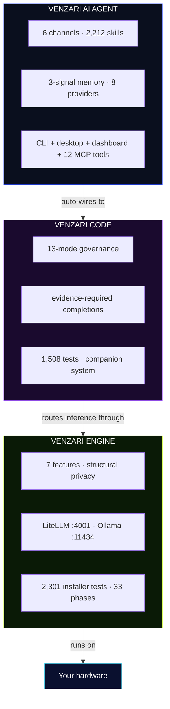

<div align="center">
  <pre align="center" style="color:#3251fc;background:#0d0d0d;padding:16px;border-radius:8px;font-size:12px">
██╗   ██╗███████╗███╗   ██╗███████╗ █████╗ ██████╗ ██╗
██║   ██║██╔════╝████╗  ██║╚══███╔╝██╔══██╗██╔══██╗██║
██║   ██║█████╗  ██╔██╗ ██║  ███╔╝ ███████║██████╔╝██║
╚██╗ ██╔╝██╔══╝  ██║╚██╗██║ ███╔╝  ██╔══██║██╔══██╗██║
 ╚████╔╝ ███████╗██║ ╚████║███████╗██║  ██║██║  ██║██║
  ╚═══╝  ╚══════╝╚═╝  ╚═══╝╚══════╝╚═╝  ╚═╝╚═╝  ╚═╝╚═╝
  </pre>

  <h1 style="font-family:'Unbounded',sans-serif;font-size:clamp(3rem,8vw,5rem);font-weight:800;color:#FDFBF9;letter-spacing:-0.02em;margin:1rem 0;">
    VENZARI
  </h1>
  <p style="font-family:'Poppins',sans-serif;font-size:1.25rem;color:rgba(253,251,249,.6);line-height:1.6;max-width:600px;margin:0 auto 2rem;">
    Private AI infrastructure · Engineering OS · Persistent autonomous agent<br/>
    The complete stack. Your hardware. Your data. Your future.
  </p>

  <p>
    <a href="https://venzari.co/code"></a>
    <a href="https://venzari.co/engine"></a>
    <a href="https://venzari.co/products/venzari-ai-agent"></a>
    <a href="https://venzari.co/together"></a>
    <a href="https://venzari.co/enterprise"></a>
  </p>
  <p>
    <a href="https://venzari.co"></a>
    <a href="https://install.venzari.xyz"></a>
    <a href="https://docs.venzari.co"></a>
    <a href="https://venzari.co/pricing"></a>
    <a href="https://discord.gg/venzari"></a>
  </p>

</div>

---

## 01 — What This Is

VENZARI is the only complete private AI ecosystem. Four products. Three new categories. Zero cloud dependency for the things that matter.

| Product | Install | Category |
|---------|---------|----------|
| [VENZARI ENGINE](https://venzari.co/engine) | `curl -fsSL https://install.venzari.xyz/engine \| sh` | Private AI infrastructure |
| [VENZARI CODE](https://venzari.co/code) | `curl -fsSL https://install.venzari.xyz \| bash` | Engineering OS |
| [VENZARI AI AGENT](https://venzari.co/products/venzari-ai-agent) | `curl -fsSL https://install.venzari.xyz/agent \| sh` | Persistent autonomous agent |
| [VENZARI Together](https://venzari.co/together) | `curl -fsSL https://install.venzari.xyz/together \| sh` | Combined stack |

---

## 02 — Architecture



---

## 03 — VENZARI CODE

> **Engineering OS** — [venzari.co/code](https://venzari.co/code)

```yaml
product: VENZARI CODE
category: Engineering OS
version: 1.0.0
tests_passing: 1508
test_files: 74
install: "curl -fsSL https://install.venzari.xyz | bash && venzari-code install"
```

The governance layer that decides what AI is allowed to do in your codebase. Not a suggestion tool — the operating system that tools run under.

### The 13 Modes

```
Primary:    Discover → Plan → Implement → Validate → Review → Repair → Commit
Secondary:  Advisor · Handoff · Audit · Benchmark · Migration · Release
```

Each mode has different tool permissions and different evidence requirements. **Validate mode** requires actual test output — not a claim. **Commit mode** is the only mode where git operations are allowed.

### What Governance Means in Practice

- 🔒 **Tool Guard** — per-mode allowlists at the system call level. Not a prompt. A constraint.
- 🔄 **Loop Detector** — 3 identical attempts without progress → stop, escalate to human
- 📋 **Evidence Collector** — every tool call logged: input, output, timestamp. Immutable. Follows every commit.
- 🧠 **SSOT Loader** — reads project rules before every action
- 🎯 **Context Assembler** — <4,000 char synthetic window with the most relevant knowledge

### The Companion System

```bash
.venzari/
├── agents/    # 6 default agents with constraints
├── skills/    # 24 native + 216 vendor templates
├── tasks/     # structured definitions with gates
├── rules/     # project-specific constraints
├── memory/    # session history + codegraph + decisions
└── gates/     # must-pass checks before task completion
```

Return months later — CODE reads the companion and knows exactly where you left off.

### Self-improvement

When you correct the AI, the correction becomes a rule. Every correction makes CODE better at working on *your* project specifically. This is not a feature — it is the architecture.

### Ships With Every Install

| Component | Details |
|-----------|---------|
| Tests | 1,508 passing, 0 failing, 74 test files |
| Desktop app | Tauri v2 (.AppImage / .deb / .rpm) |
| JetBrains plugin | v0.2.2, 1.6 MB |
| Dashboard | Laravel app in product tarball |
| MCP server | 6 tools (doctor / list_tasks / get_logs / get_context / get_mode / run_automation) |
| Languages | 6 (en/es/fr/de/ja/pt) |
| Security CI | 4-job pipeline: dep-audit / secret-scan / license-check / SBOM |
| Multi-agent | SubagentPool + SwarmCoordinator + DAG branching |
| Goal mode | `venzari-code goal "<objective>"` with budget + parallel caps |

---

## 04 — VENZARI ENGINE

> **Private AI Infrastructure** — [venzari.co/engine](https://venzari.co/engine)

```yaml
product: VENZARI ENGINE
category: Private AI Infrastructure
version: 1.0.0
phases_complete: 33
installer_tests: 2301
launched: 2026-09-05
install: "curl -fsSL https://install.venzari.xyz/engine | sh"
```

A complete AI system on any Linux VPS you own. 20 minutes from nothing to a full private AI stack.

### Structural Privacy vs Policy Privacy

```
Cloud AI:        Your data → vendor server → privacy policy (can change)
VENZARI ENGINE:  Your data → your server → no vendor access mechanism
```

You can close the internet connection after installation. The system keeps running.

### 7 Features

| # | Feature | What it means |
|---|---------|---------------|
| 1 | **Conversational AI + permanent memory** | Every conversation, every decision, indefinitely and privately |
| 2 | **Local voice** | Offline TTS + STT. Voice data never leaves. |
| 3 | **Workflow automation** | Reports, email, CRM, calendar — all local API calls |
| 4 | **Web dashboard** | Full UI at your domain: `ai.yourcompany.com` |
| 5 | **REST API** | Connect ERP, CRM, HR systems — all locally |
| 6 | **Semantic search** | *"What did we discuss about Acme in March?"* → instant answer |
| 7 | **Custom fine-tuning** *(Growth+)* | Train on your data, run locally |

### The 3-Stage Installer

**Stage 1 — 11 pre-install checks (parallel, automatic):**
```
RAM: warn <16GB / fail <8GB
Disk: warn <40GB / fail <60GB
Ports 4001/11434/5432/6379: fail if occupied
Docker: fail if not installed or not running
Internet: fail if no connectivity to installer.venzari.xyz
Sudo access: fail if unavailable
```

**Stage 2 — 7-question wizard:**
```
Server identity (domain, company, email)
License key validation
AI provider: local-only / local+cloud / cloud-only
Model selection (hardware-adaptive)
Add-ons (Growth+ features)
Final confirmation
```

**Stage 3 — 17-step hardware-customized plan:**
```
Hardware profile → installer.venzari.xyz → customized plan for your machine
Binary download (SHA256) → models → docker-compose → health checks
SSL/nginx → ecosystem wiring → MCP registration
Resumable: venzari-engine install --repair
2,301 automated tests back every step
```

### Hardware

```yaml
minimum:
  ram: "8 GB (warns at < 16 GB)"
  disk: "60 GB SSD"
  cpu: "4 cores"
  gpu: "optional"
  os: "Ubuntu 22.04 LTS"

recommended:
  ram: "32–64 GB"
  disk: "200 GB NVMe"
  cpu: "16+ cores"
  gpu: "NVIDIA ≥ 8 GB VRAM (5–15× faster inference)"
```

### All 33 Phases Complete

```yaml
phases_0_to_15: "Core AI stack · wizard · installer · LiteLLM · SSL · security · observability"
phase_8: "Resumable state machine: --repair, --reset"
phase_12: "Custom training pipeline (Growth+)"
phase_13: "Security hardening · Authelia · backup · secret rotation"
phase_14: "Prometheus + Grafana observability (Growth+)"
phase_15: "Self-update: venzari-engine upgrade"
phase_21: "CLI i18n: 6 languages, 21 keys"
phase_22: "Security CI: 0 vulns · 0 secrets · 0 GPL/AGPL · CycloneDX SBOM"
phase_23: "Ecosystem: auto-detect CODE + AI AGENT"
phase_30: "MCP server: 16 tools"
phase_32: "E2E smoke test: 15/15 checks"
phase_33: "v1.0.0 launch: R2 artifacts · install.venzari.xyz · GitHub Release"
```

---

## 05 — VENZARI AI AGENT

> **Persistent Autonomous Agent** — [venzari.co/products/venzari-ai-agent](https://venzari.co/products/venzari-ai-agent)

```yaml
product: VENZARI AI AGENT
category: Persistent Autonomous Agent
version: 1.1.0
tests_passing: 422
skills_total: 2212
channels: 6
providers: 8
install: "curl -fsSL https://install.venzari.xyz/agent | sh"
```

Not a chatbot. An always-on entity that operates across every channel you use, remembers everything permanently, and gets smarter every single night.

### 6 Live Channels

Start on Telegram. Continue on Slack. Finish via email. Same agent. Same memory. Zero re-explaining.

`Telegram` · `Slack` · `Discord` · `Email` · `Web chat` · `Webhook`

### 3-Signal Memory

```yaml
vector_embeddings:
  latency: 50ms
  use_case: "semantic search — finds relevant content even without exact words"
bm25_full_text:
  latency: 10ms
  use_case: "exact phrase matching — code snippets, names, precise terms"
pagerank_graph:
  latency: 5ms
  use_case: "importance weighting — most-referenced facts surface first"
```

### 2,212 Skills

```
S-tier:  11    Flagship. Highest reliability. Most maintained.
A-tier:  522   High quality. Broad coverage. Day-to-day backbone.
B-tier:  1679  Community catalog. Wide reach. Growing continuously.
```

Invoked automatically from context. No manual selection.

### The Nightly Learning Loop

```bash
# Runs at 3am (configurable) every night, automatically:
1. Detect repeated patterns → create new skills
2. Rate skill performance → improve underperformers
3. Update context model → know you better
4. Compress old interactions → retain key facts
```

### 8-Provider Router

```yaml
providers:
  - Local Ollama: "default — free, private, zero-config"
  - Groq: "fast inference, free API tier"
  - Gemini: "free API tier available"
  - OpenRouter: "broad model access"
  - Cerebras: "ultra-fast inference"
  - Anthropic: "Claude models"
  - OpenAI: "GPT models"
  - Bedrock: "AWS enterprise"
circuit_breaker: "3 failures → bypass → auto-recovery"
budget_monitor: "downgrade at 80% of session budget"
engine_integration: "auto-routes through ENGINE LiteLLM :4001"
```

### Full Component List

| Component | Spec |
|-----------|------|
| CLI binary | `venzari-agent` · 15+ commands |
| Desktop app | Tauri v2 + SolidJS · 5 tabs · system tray |
| Dashboard | 9 pages at agent.venzari.co (incl. AI Router — unique in market) |
| MCP server | 12 tools for Claude Code / Cursor / Kiro / VS Code / Gemini CLI |
| Tests | 422 passing · 0 failing |
| Ecosystem | Auto-detects + wires to ENGINE and CODE |

---

## 06 — VENZARI Together

> **Complete Stack** — [venzari.co/together](https://venzari.co/together)

```bash
curl -fsSL https://install.venzari.xyz/together | sh
```

CODE + ENGINE, one machine, fully wired. CODE routes all AI inference through ENGINE's LiteLLM at :4001. Zero cloud calls for development. Offline capable after install.

```
Your Machine
  venzari-code CLI → LiteLLM :4001 → Ollama :11434 (local models)
  ENGINE Dashboard :3000
  ~/.venzari-together/
```

```yaml
requirements:
  ram: "8 GB minimum, 16 GB recommended"
  disk: "20 GB minimum"
  os: "Ubuntu 20.04+"
  gpu: "optional"
install_plan: "22-step hardware-aware"
offline: true
```

---

## 07 — Comparison

| | Cloud AI | DIY Stack | Enterprise Platform | VENZARI |
|---|---|---|---|---|
| Data location | Vendor cloud | Your server | Vendor cloud | **Your server** |
| Price model | Per-token | Staff cost | $50,000+/year | **Flat monthly** |
| Privacy | Policy | DIY | Policy | **Architecture** |
| Setup time | Minutes | 3–6 months | 3–6 months | **20 minutes** |
| Memory | Session | DIY | Varies | **Permanent** |
| Governance (dev) | None | None | None | **13-mode lifecycle** |
| Multi-channel agent | No | No | Varies | **6 channels** |
| Tests | N/A | Ad hoc | Varies | **1,508 + 2,301 installer** |

---

## 08 — Use Cases

| Industry | Use case | Products |
|----------|----------|---------|
| Healthcare | Patient data AI that never leaves premises | ENGINE |
| Legal | Case research with structural confidentiality | ENGINE |
| Finance | Trade research + internal knowledge base | ENGINE + CODE |
| Software team | AI development with full audit trails | CODE |
| Operations | Multi-channel automation agent | AI AGENT |
| Startup | Full private AI stack from day one | Together |
| Enterprise | White-label AI for clients | Enterprise |

---

## 09 — Install

```bash
# Private AI infrastructure
curl -fsSL https://install.venzari.xyz/engine | sh

# Engineering OS
curl -fsSL https://install.venzari.xyz | bash && venzari-code install

# Persistent agent
curl -fsSL https://install.venzari.xyz/agent | sh

# CODE + ENGINE together
curl -fsSL https://install.venzari.xyz/together | sh
```

**Starting at $29/month.** No per-token billing. No data leaving your hardware.

---

## 10 — Resources

[venzari.co](https://venzari.co) · [CODE](https://venzari.co/code) · [ENGINE](https://venzari.co/engine) · [AI AGENT](https://venzari.co/products/venzari-ai-agent) · [Together](https://venzari.co/together) · [Enterprise](https://venzari.co/enterprise) · [Pricing](https://venzari.co/pricing) · [Docs](https://docs.venzari.co) · [Install](https://install.venzari.xyz) · [Solutions](https://venzari.co/solutions) · [Jobs](https://venzari.co/jobs) · [Contact](https://venzari.co/contact) · [Discord](https://discord.gg/venzari)

---

<div style="margin-top:3rem;padding-top:2rem;border-top:1px solid rgba(255,255,255,.08);color:rgba(253,251,249,.6);font-size:.85rem;line-height:1.6;">
  © 2026 VENZARI<br/>
  <em>Your AI. Your Hardware. Your Future.</em>
</div>

<script>
  (function() {
    var html = document.documentElement;
    html.style.fontFamily = "'Poppins','Unbounded',system-ui,sans-serif";
    var heads = document.getElementsByTagName('head');
    if (heads.length > 0) {
      var link = document.createElement('link');
      link.rel = 'preconnect'; link.href = 'https://fonts.googleapis.com';
      heads[0].appendChild(link);
      var unbounded = document.createElement('link');
      unbounded.rel = 'stylesheet';
      unbounded.href = 'https://fonts.googleapis.com/css2?family=Unbounded&display=swap';
      heads[0].appendChild(unbounded);
    }
  })();
</script>
