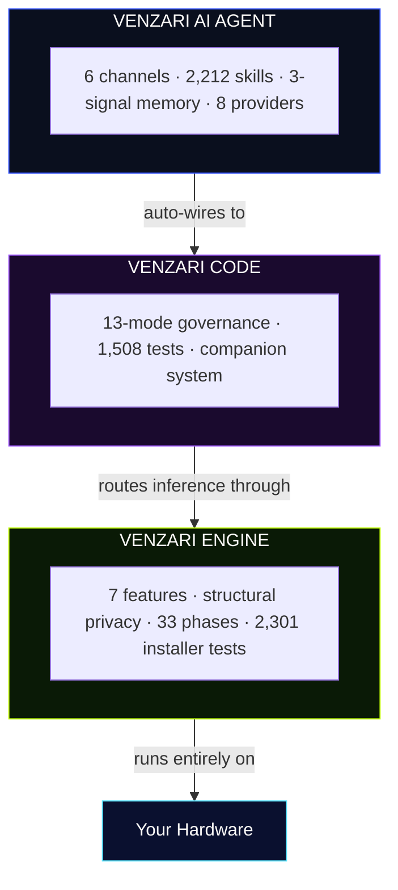

<div align="center">
  <pre align="center" style="color:#3251fc;background:#0d0d0d;padding:16px;border-radius:8px;font-size:12px">
██╗   ██╗███████╗███╗   ██╗███████╗ █████╗ ██████╗ ██╗
██║   ██║██╔════╝████╗  ██║╚══███╔╝██╔══██╗██╔══██╗██║
██║   ██║█████╗  ██╔██╗ ██║  ███╔╝ ███████║██████╔╝██║
╚██╗ ██╔╝██╔══╝  ██║╚██╗██║ ███╔╝  ██╔══██║██╔══██╗██║
 ╚████╔╝ ███████╗██║ ╚████║███████╗██║  ██║██║  ██║██║
  ╚═══╝  ╚══════╝╚═╝  ╚═══╝╚══════╝╚═╝  ╚═╝╚═╝  ╚═╝╚═╝
  </pre>
  <h1 style="font-family:'Unbounded',sans-serif;font-size:clamp(3rem,8vw,5rem);font-weight:800;color:#FDFBF9;letter-spacing:-0.02em;margin:1rem 0;">VENZARI</h1>
  <p style="font-family:'Poppins',sans-serif;font-size:1.25rem;color:rgba(253,251,249,.6);line-height:1.6;max-width:640px;margin:0 auto 2rem;">
    Private AI infrastructure · Engineering OS · Persistent autonomous agent<br/>
    <strong style="color:#FDFBF9;">The complete stack. Your hardware. Your data. Your future.</strong>
  </p>
  <p>
    <a href="https://venzari.co/code"></a>
    <a href="https://venzari.co/engine"></a>
    <a href="https://venzari.co/products/venzari-ai-agent"></a>
    <a href="https://venzari.co/together"></a>
    <a href="https://venzari.co/enterprise"></a>
  </p>
  <p>
    <a href="https://venzari.co"></a>
    <a href="https://install.venzari.xyz"></a>
    <a href="https://docs.venzari.co"></a>
    <a href="https://venzari.co/pricing"></a>
    <a href="https://discord.gg/venzari"></a>
  </p>
</div>

---

## 01 — What VENZARI Is

The only complete private AI ecosystem. Four products. Three new categories. Zero cloud dependency.

| Product | Category | Install |
|---------|----------|---------|
| [VENZARI ENGINE](https://venzari.co/engine) | Private AI Infrastructure | `curl -fsSL https://install.venzari.xyz/engine \| sh` |
| [VENZARI CODE](https://venzari.co/code) | Engineering OS | `curl -fsSL https://install.venzari.xyz \| bash` |
| [VENZARI AI AGENT](https://venzari.co/products/venzari-ai-agent) | Persistent Autonomous Agent | `curl -fsSL https://install.venzari.xyz/agent \| sh` |
| [VENZARI Together](https://venzari.co/together) | Complete Stack | `curl -fsSL https://install.venzari.xyz/together \| sh` |

---

## 02 — Architecture



---

## 03 — VENZARI CODE

> **Engineering OS** · [venzari.co/code](https://venzari.co/code)

```yaml
product: VENZARI CODE
version: 1.0.0
tests_passing: 1508
test_files: 74
modes: 13
install: "curl -fsSL https://install.venzari.xyz | bash && venzari-code install"
```

Not an AI coding assistant. The governance layer above AI models — the operating system that decides what AI is allowed to do, in which phase, with what evidence required to complete.

### 13 Modes

| # | Mode | Permitted | Evidence |
|---|------|-----------|---------|
| 1 | **Discover** | Read only · zero writes | Observational report |
| 2 | **Plan** | Write plan document · no code | Plan document |
| 3 | **Implement** | Execute within approved scope | Working code |
| 4 | **Validate** | Run tests · **actual output required** | Real test results |
| 5 | **Review** | Read-only · static + security scan | Review report |
| 6 | **Repair** | Fix specific failure · scope locked | Fix diff |
| 7 | **Commit** | Git operations only | Structured commit + evidence chain |
| 8 | **Advisor** | Analysis only · no writes | Analysis document |
| 9 | **Handoff** | Session summary | Handoff document |
| 10 | **Audit** | Review evidence records | Audit report |
| 11 | **Benchmark** | Performance regression | Benchmark data |
| 12 | **Migration** | Full write + execute for large changes | Migration plan |
| 13 | **Release** | Full access including deploy | Release evidence |

### Governance

```yaml
ssot_loader:       "reads project rules before every action"
tool_guard:        "per-mode allowlists at system call level — not a prompt"
loop_detector:     "3 identical attempts without progress → stop + escalate"
evidence_collector: "every tool call logged: input · output · timestamp · immutable"
context_assembler: "<4,000 char synthetic window of most relevant project knowledge"
```

### Companion System

```bash
.venzari/
├── agents/    # 6 default agents with specific constraints
├── skills/    # 24 native + 216 vendor templates
├── tasks/     # structured with opening/closing gates
├── rules/     # project-specific constraint overrides
├── memory/    # session history · codegraph · decisions
└── gates/     # must-pass checks before task completion
```

Return months later — CODE reads the companion and knows exactly where it left off. Corrections become rules — gets better at your project over time.

### What Ships

| Component | Spec |
|-----------|------|
| Tests | 1,508 passing · 0 failing · 74 test files |
| Desktop app | Tauri v2 (.AppImage / .deb / .rpm) |
| JetBrains plugin | v0.2.2 · 1.6 MB |
| Dashboard | Laravel app in every product tarball |
| MCP server | 6 tools |
| Languages | 6 (en/es/fr/de/ja/pt) |
| Security CI | 4 jobs: dep-audit / secret-scan / license / SBOM |
| Multi-agent | SubagentPool + SwarmCoordinator + DAG branching |
| Goal mode | `venzari-code goal "<objective>"` — autonomous, budget-capped |

---

## 04 — VENZARI ENGINE

> **Private AI Infrastructure** · [venzari.co/engine](https://venzari.co/engine)

```yaml
product: VENZARI ENGINE
version: 1.0.0
phases_complete: 33
installer_tests: 2301
launched: 2026-09-05
install: "curl -fsSL https://install.venzari.xyz/engine | sh"
```

### Structural Privacy

```
Cloud AI:        data → vendor server → privacy policy (can change)
VENZARI ENGINE:  data → your server  → no access mechanism exists
                 Offline capable · You own the binary · Privacy = architecture
```

### 7 Features

| # | Feature | What it means |
|---|---------|---------------|
| 1 | Conversational AI + permanent memory | Every conversation, every decision, permanently private |
| 2 | Local voice (TTS + STT) | Offline, zero cloud audio processing |
| 3 | Workflow automation | Reports · email · CRM · calendar — all local |
| 4 | Web dashboard | Full UI at `ai.yourcompany.com` |
| 5 | REST API | Connect ERP · CRM · HR locally |
| 6 | Semantic memory search | Natural language recall across all stored knowledge |
| 7 | Custom fine-tuning *(Growth+)* | Train locally · model runs locally |

### The 3-Stage Installer

```bash
# Stage 1: 11 parallel pre-install checks
# RAM: warn <16GB · fail <8GB
# Disk: warn <40GB · fail <60GB
# Ports 4001/11434/5432/6379: fail if occupied
# Docker: fail if not installed/running
# Internet/Sudo: fail if unavailable
# → Any failure: STOP with exact fix instructions

# Stage 2: 7-question wizard
# Server identity · License · AI provider · Model selection · Add-ons

# Stage 3: 17-step hardware-customized plan
# Binary (SHA256) → models → compose → health checks
# → SSL → ecosystem wiring → MCP registration
venzari-engine install --repair   # resumable at any point
# 2,301 automated tests back every step
```

### Hardware

```yaml
minimum:     { ram: "8 GB", disk: "60 GB SSD", cpu: "4 cores" }
recommended: { ram: "32-64 GB", disk: "200 GB NVMe", cpu: "16+", gpu: "NVIDIA ≥8 GB VRAM" }
gpu_speedup: "5–15× faster inference"
```

### 33 Phases Complete

```yaml
0-15: "core stack · wizard · LiteLLM · SSL · security · observability"
12:   "custom training pipeline (Growth+)"
13:   "security hardening · Authelia · backup · secret rotation"
14:   "Prometheus + Grafana (Growth+)"
15:   "self-update: venzari-engine upgrade"
22:   "security CI: 0 vulns · 0 secrets · 0 GPL · SBOM"
23:   "ecosystem: auto-detect CODE + AI AGENT"
30:   "MCP server: 16 tools"
33:   "v1.0.0 public launch · GitHub Release"
```

---

## 05 — VENZARI AI AGENT

> **Persistent Autonomous Agent** · [venzari.co/products/venzari-ai-agent](https://venzari.co/products/venzari-ai-agent)

```yaml
product: VENZARI AI AGENT
version: 1.1.0
tests_passing: 422
skills: 2212  # 11 S-tier + 522 A-tier + 1679 B-tier
channels: 6
providers: 8
install: "curl -fsSL https://install.venzari.xyz/agent | sh"
```

### 6 Live Channels

`Telegram` · `Slack` · `Discord` · `Email (Mailgun/Acelle)` · `Web chat` · `Webhook`

Start on Telegram. Continue on Slack. Finish via email. Same agent. Same memory. Zero re-explaining.

### 3-Signal Memory

```yaml
vector_embeddings: { latency: "50ms", use_case: "semantic — relevant content without exact words" }
bm25_full_text:    { latency: "10ms", use_case: "exact — code snippets, names, precise terms" }
pagerank_graph:    { latency: "5ms",  use_case: "important — most-referenced facts surface first" }
```

### 2,212 Skills

```yaml
s_tier: { count: 11, description: "flagship · highest reliability · most maintained" }
a_tier: { count: 522, description: "high quality · broad coverage · day-to-day backbone" }
b_tier: { count: 1679, description: "community catalog · wide reach · growing" }
invocation: "automatic from context — no manual selection"
cli: "venzari-agent skills list | search '<keyword>' | run <id>"
```

### Nightly Learning Loop

```yaml
schedule: "3am daily (configurable)"
1: "identify repeated patterns → create new skills"
2: "rate skill performance → improve underperformers"
3: "update context model → know you better"
4: "compress old interactions → retain key facts"
```

### 8-Provider Router

```yaml
providers: [Ollama, Groq, Gemini, OpenRouter, Cerebras, Anthropic, OpenAI, Bedrock]
circuit_breaker: "3 failures → bypass + auto-recovery"
budget_monitor:  "downgrade at 80% of session budget"
engine:          "auto-routes through ENGINE LiteLLM :4001 — zero config"
```

### Component List

| Component | Details |
|-----------|---------|
| CLI binary | `venzari-agent` · 15+ commands |
| Desktop app | Tauri v2 · 5 tabs · system tray |
| Dashboard | 9 pages at agent.venzari.co (AI Router page = unique in market) |
| MCP server | 12 tools for Claude Code / Cursor / Kiro / VS Code / Gemini CLI |
| Ecosystem | Auto-detects + wires to ENGINE and CODE |

---

## 06 — VENZARI Together

> **Complete Stack** · [venzari.co/together](https://venzari.co/together)

```bash
curl -fsSL https://install.venzari.xyz/together | sh
```

CODE + ENGINE, one machine, fully wired. CODE routes all inference through ENGINE's LiteLLM at :4001. Zero cloud calls for development. Offline after install.

```
venzari-code → LiteLLM :4001 → Ollama :11434 → local models
                    ↑ ENGINE provides
venzari-together doctor   # health check all services
venzari-together status   # combined status + model list
```

```yaml
minimum:     { ram: "8 GB", disk: "20 GB", os: "Ubuntu 20.04+" }
recommended: { ram: "16 GB", gpu: "NVIDIA 8 GB+ VRAM" }
plan_steps:  22
offline:     true
```

---

## 07 — Comparison

| | Cloud AI | DIY Stack | Enterprise | **VENZARI** |
|---|---|---|---|---|
| Data location | Vendor | Your server | Vendor | **Your server** |
| Privacy | Policy | DIY | Policy | **Architecture** |
| Price | Per-token | Staff cost | $50K+/yr | **Flat monthly** |
| Setup | Minutes/months | 3–6 months | 3–6 months | **20 minutes** |
| Memory | Session | DIY | Varies | **Permanent** |
| Dev governance | None | None | None | **13 modes** |
| Offline | No | Yes | No | **Yes** |

---

## 08 — Use Cases

| Industry | Use case | Products |
|----------|----------|---------|
| Healthcare | Patient data AI that cannot leave premises | ENGINE |
| Legal | Confidential case research | ENGINE |
| Finance | Private AI + governed development | ENGINE + CODE |
| Engineering team | AI development with audit trails | CODE |
| Operations | Multi-channel autonomous agent | AI AGENT |
| Startup | Complete private AI from day one | Together |
| Enterprise | White-label AI under your brand | Enterprise |

---

## 09 — Start

```bash
curl -fsSL https://install.venzari.xyz/engine | sh          # private AI
curl -fsSL https://install.venzari.xyz | bash               # engineering OS
curl -fsSL https://install.venzari.xyz/agent | sh           # agent ($29/mo)
curl -fsSL https://install.venzari.xyz/together | sh        # full stack
```

[venzari.co](https://venzari.co) · [Pricing](https://venzari.co/pricing) · [Docs](https://docs.venzari.co) · [Enterprise](https://venzari.co/enterprise) · [Solutions](https://venzari.co/solutions) · [Jobs](https://venzari.co/jobs) · [Contact](https://venzari.co/contact) · [Discord](https://discord.gg/venzari)

---

<div style="margin-top:3rem;padding-top:2rem;border-top:1px solid rgba(255,255,255,.08);color:rgba(253,251,249,.6);font-size:.85rem;line-height:1.6;">
  © 2026 VENZARI<br/>
  <em>Your AI. Your Hardware. Your Future.</em>
</div>

<script>
  (function() {
    var html = document.documentElement;
    html.style.fontFamily = "'Poppins','Unbounded',system-ui,sans-serif";
    var heads = document.getElementsByTagName('head');
    if (heads.length > 0) {
      var link = document.createElement('link');
      link.rel = 'preconnect'; link.href = 'https://fonts.googleapis.com';
      heads[0].appendChild(link);
      var unbounded = document.createElement('link');
      unbounded.rel = 'stylesheet';
      unbounded.href = 'https://fonts.googleapis.com/css2?family=Unbounded&display=swap';
      heads[0].appendChild(unbounded);
    }
  })();
</script>
