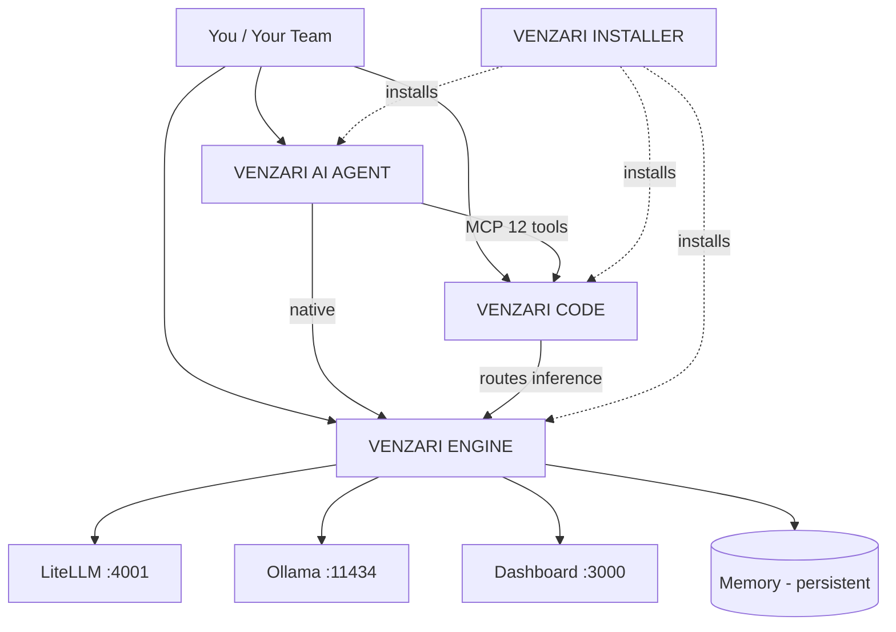
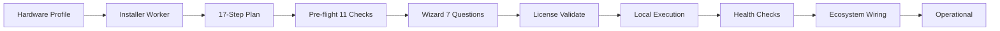

# VENZARI — Technical Specification

<div align="center">

<pre align="center" style="color:#3251fc;background:#0d0d0d;padding:16px;border-radius:8px;font-size:12px">
██╗   ██╗███████╗███╗   ██╗███████╗ █████╗ ██████╗ ██╗
██║   ██║██╔════╝████╗  ██║╚══███╔╝██╔══██╗██╔══██╗██║
██║   ██║█████╗  ██╔██╗ ██║  ███╔╝ ███████║██████╔╝██║
╚██╗ ██╔╝██╔══╝  ██║╚██╗██║ ███╔╝  ██╔══██║██╔══██╗██║
 ╚████╔╝ ███████╗██║ ╚████║███████╗██║  ██║██║  ██║██║
  ╚═══╝  ╚══════╝╚═╝  ╚═══╝╚══════╝╚═╝  ╚═╝╚═╝  ╚═╝╚═╝
</pre>

<p style="font-family:'Unbounded',sans-serif;font-size:clamp(2.4rem,7vw,4.4rem);font-weight:800;color:#3251fc;letter-spacing:-0.02em;margin:1rem 0 0.25rem;">
VENZARI
</p>
<p style="font-family:'JetBrains Mono',ui-monospace,monospace;font-size:1rem;color:#5EE7FF;letter-spacing:.02em;margin:0 0 1.5rem;">
// the complete AI stack you own — engineering OS · private AI infrastructure · persistent agent
</p>

<p align="center">
  <a href="https://venzari.co/code"></a>
  <a href="https://venzari.co/engine"></a>
  <a href="https://venzari.co/products/venzari-ai-agent"></a>
  <a href="https://venzari.co/together"></a>
  <a href="https://venzari.co/enterprise"></a>
</p>

<p align="center">
  <a href="https://venzari.co/pricing"></a>
  
  
  
</p>

</div>

<br/>

---

## 00 — THE PROBLEM

```yaml
status: critical
scope: every team that depends on AI for real work
```

**You have been renting your two most important tools.** Your engineering OS and your intelligence layer. The bills are predictable until they aren't. The privacy policy is a document you did not write. The session ends and the context is gone. The data lives on someone else's disk, under someone else's retention policy, behind someone else's support SLA.

```yaml
what_you_actually_need:
  - ownership_of_the_binary
  - ownership_of_the_data
  - ownership_of_the_future
  - an_agent_that_remembers
  - governance_that_actually_governs
  - a_setup_that_does_not_require_a_platform_team
```

```yaml
what_you_currently_have:
  per_token_billing: true
  data_leaves_your_hardware: true
  forgets_between_sessions: true
  one_channel_one_tool: true
  vendor_controls_the_model: true
  setup_measured_in_weeks: true
```

> Everyone else sells you a piece. VENZARI sells you the whole exit.

---

## 01 — THE STACK



| Layer | Product | Responsibility | Public Entry Point |
|-------|---------|----------------|--------------------|
| L4 | **AI AGENT** | Persistent autonomous entity across every channel | [venzari.co/products/venzari-ai-agent](https://venzari.co/products/venzari-ai-agent) |
| L3 | **CODE** | Governance substrate for AI-assisted engineering | [venzari.co/code](https://venzari.co/code) |
| L2 | **ENGINE** | Private AI infrastructure, memory, workflows, voice | [venzari.co/engine](https://venzari.co/engine) |
| L1 | **TOGETHER** | The unified stack — one command, one license | [venzari.co/together](https://venzari.co/together) |
| L0 | **ENTERPRISE** | Custom deployment, SLA, dedicated infra | [venzari.co/enterprise](https://venzari.co/enterprise) |
| — | **INSTALLER** | Autonomous setup for all of the above | `install.venzari.xyz` |

---

## 02 — VENZARI CODE / Engineering OS

**Category:** Not an AI coding assistant. An operating system for AI-assisted development — the substrate that decides *when* an AI may act, *how far*, and *with what proof*.

```yaml
product: VENZARI CODE
version: 1.0.0
distribution: LIVE
install: curl -FsSL https://install.venzari.xyz | bash
tests: 1508 passing / 0 failing  (74 test files)
pre_install_checker: 6 checks (CODE-A)
modes: 13 enforced
```

### 02.1 Mode Lifecycle

```
Discover → Plan → Implement → Validate → Review → Repair → Commit
Advisor | Handoff | Audit | Benchmark | Migration | Release
```

| Mode | Writes | Executes | Git | Risk | Gate |
|------|--------|----------|-----|------|------|
| Discover | no | no | no | LOW | observational only |
| Plan | plan doc | no | no | LOW | must precede Implement |
| Implement | scoped | scoped | no | MED | within approved plan |
| Validate | no | tests | no | HIGH | real test output required |
| Review | no | analysis | no | HIGH | read-only static + security scan |
| Repair | scoped | scoped | no | MED | scope locked to failure |
| Commit | no | no | YES | HIGH | only mode with git access |
| Advisor | no | no | no | LOW | analysis only |
| Handoff | doc | no | no | LOW | structured handoff |
| Audit | no | no | no | LOW | evidence review |
| Benchmark | no | benchmarks | no | LOW | perf regression tracking |
| Migration | full | full | no | HIGH | full write + execute |
| Release | full | full | YES | CRITICAL | evidence-gated deploy |

### 02.2 Companion System

`venzari-code install` creates `.venzari/` in your project:

| Directory | Contents | Status |
|-----------|----------|--------|
| `agents/` | 6 default agent roles with scoped capabilities and tool guards | LIVE |
| `skills/` | 2,212 reusable task templates, auto-invoked by intent | LIVE |
| `tasks/` | Structured task definitions with opening + closing gates | LIVE |
| `rules/` | Project-level constraints that override defaults | LIVE |
| `memory/` | Session history, codegraph, architectural decisions (SQLite) | LIVE |
| `context/` | Automatic context loading, project state, dependency maps | LIVE |

### 02.3 Governance Guarantees

```yaml
evidence_required_on: [Validate, Review, Commit, Release]
tool_guards: enforced_per_mode
loop_detection: 3_strike_escalation
completion_rule: task CANNOT be marked complete without closing skill
drift_detection: python3 cto/ops/agent/drift_scanner.py "<task-keyword>"
```

> Unlike every AI coding assistant on the market, VENZARI CODE cannot be convinced that the work is done. It runs the closing skill, shows the evidence, and only then closes the task.

**[→ venzari.co/code](https://venzari.co/code)**

---

## 03 — VENZARI ENGINE / Private AI Infrastructure

**Category:** Not a cloud AI API. A complete private AI system running on your own hardware, at flat cost, with a privacy guarantee that is architectural rather than contractual.

```yaml
product: VENZARI ENGINE
version: 1.0.0
status: ALL 33 PHASES COMPLETE
launched: 2026-09-05
tests: 2301 automated
offline_after_install: true
per_token_billing: false
```

### 03.1 Capability Matrix

| # | Capability | Status | Notes |
|---|------------|--------|-------|
| 1 | Conversational AI with persistent memory | LIVE | Every conversation retained indefinitely, privately |
| 2 | Local voice synthesis + recognition | OFFLINE | TTS + STT on your own hardware, no third-party audio processing |
| 3 | Business workflow automation | LIVE | Scheduled reports, email drafting, CRM queries, SQL, APIs, calendar |
| 4 | Web dashboard | LIVE | Own your domain (`ai.acme.com`) — chat, memory search, voice, workflows, monitoring, users |
| 5 | Local REST API | LIVE | Wire into ERP / CRM / ticketing / HR. All local. |
| 6 | Semantic memory search | LIVE | Natural-language query across everything ever learned |
| 7 | Custom fine-tuning pipeline | GROWTH+ | Train on your own conversations; model runs locally |

```yaml
scope_boundary:
  engine_is_for: [business_operations, http, email, sql, crm, calendar]
  engine_is_not_for: [code_repository_editing]   # that is CODE's job
```

### 03.2 Privacy Model

```yaml
data_location: your_hardware
data_transit: none_required
vendor_access_path: structurally_impossible
guarantee_type: architectural      # not contractual, not policy-based
guarantee_survives: [policy_change, acquisition, legal_request, vendor_shutdown]
offline_operation: full_functionality
```

> "We don't just say your data is private. Your data physically cannot leave your hardware."

| Scenario | Cloud AI | VENZARI ENGINE |
|----------|----------|-----------------|
| Vendor changes privacy policy | Your data now covered by new terms | Unaffected — no data there |
| Vendor acquired | New owner gains your data | Unaffected — no data there |
| Legal request to vendor | Data may be disclosed | Nothing to disclose |
| Vendor shuts down | Service ends, data at risk | System keeps running |
| Cost spike at scale | Per-token, unbounded | Flat monthly |

### 03.3 Installer Pipeline

```yaml
stage_1_preflight:
  checks: 11
  parallel: true
  enforces:
    ram:    {warn_below: 8GB, fail_below: 8GB}
    disk:   {warn_below: 60GB, fail_below: 60GB}
    ports:  [4001, 11434, 5432, 6379]
    docker: {installed: true, running: true}
    network: installer.venzari.xyz reachable
    sudo: true
    existing_install: detect
  on_failure: abort_with_exact_fix_instructions

stage_2_wizard:
  questions: 7
  fields:
    - server_identity   # domain or IP, company name, admin email
    - license_key       # validated at this step
    - ai_provider_mode  # local_only | local_with_cloud_fallback | cloud_only
    - hardware_adaptive_model_recommendations
    - optional_addons   # Growth+ only
    - final_confirmation

stage_3_worker_plan:
  steps: 17
  source: installer.venzari.xyz (VENZARI Installer Worker)
  personalization: [hardware_tier, license_tier]
  steps_include:
    - pre-install verification
    - binary download
    - AI model pulls (fast + reasoning + embedding)
    - docker-compose write + service startup
    - per-service health checks
    - gateway configuration (probes all configured providers)
    - SSL + nginx configuration
    - ecosystem wiring (detects co-installed CODE / AI AGENT)
    - MCP registration
    - anonymous install count ping
  retry_logic: per_step
  resumable: venzari-engine install --repair
```

### 03.4 Hardware Requirements

| Resource | Minimum | Recommended |
|----------|---------|-------------|
| CPU | 4 cores | 16+ cores |
| RAM | 8 GB (warns) / 16 GB comfortable | 32–64 GB |
| Storage | 60 GB SSD | 200+ GB NVMe |
| GPU | Not required | NVIDIA ≥8 GB VRAM (CUDA) |
| OS | Ubuntu 22.04 LTS | Ubuntu 22.04 LTS |
| Network | Static IP recommended | Static IP |

### 03.5 Pricing

| Tier | Price | Includes |
|------|-------|----------|
| Foundation | $349/mo | Private AI — knowledge, conversation, memory |
| Growth | $899/mo | + custom AI training, observability dashboards, Growth+ features |
| Enterprise | $2,499/mo | + white-label, SLA, enterprise support |
| Founder-Guided Setup | $2,499 one-time | Done-with-you install + configuration |

```yaml
licensing:
  key_gates: real_binary_download
  offline_grace: 24h
  phone_home_required: false
  works_if_venzari_ceases_to_exist: true
```

**[→ venzari.co/engine](https://venzari.co/engine)**

---

## 04 — VENZARI AI AGENT / Persistent Autonomous Agent

**Category:** Not a chatbot. A persistent autonomous entity with permanent memory, cross-channel presence, self-improving capability, and an 8-provider model router.

```yaml
product: VENZARI AI AGENT
version: 1.1.0
tests: 422 passing / 0 failing
channels_live: 6
skills: 2212   # 11 S-tier + 522 A-tier + 1679 B-tier
model_providers: 8
```

### 04.1 Channels

| Channel | Status | Notes |
|---------|--------|-------|
| Telegram | LIVE | Full bot integration, persistent session |
| Slack | LIVE | Workspace app, DM + channel |
| Discord | LIVE | Bot + server integration |
| Email | LIVE | Mailgun / Acelle transport |
| Web chat widget | LIVE | Embeddable on any site |
| Webhook | LIVE | Programmatic entry point |

> One instance, one identity, one memory — across every channel simultaneously. Start on Telegram, finish on Slack, continue by email. Context follows.

### 04.2 Memory Retrieval — Three Signals

| Signal | Method | Latency | Returns |
|--------|--------|---------|---------|
| Vector embeddings | Semantic similarity | ~50 ms | Meaning-matched past conversations |
| BM25 full-text | Lexical exact match | ~10 ms | Code snippets, exact phrases, error strings |
| PageRank graph | Importance ranking | ~5 ms | Key facts, highly-referenced memories |

### 04.3 Skill Tiers

| Tier | Count | Guarantee |
|------|-------|-----------|
| S-tier | 11 | Highest quality, flagship capabilities, hand-verified |
| A-tier | 522 | High quality, broad coverage, tested |
| B-tier | 1,679 | Community catalog, wide reach |
| **Total** | **2,212** | Invoked automatically by intent — no manual selection |

### 04.4 Model Router

| Provider | Latency Class | Cost | Role |
|----------|---------------|------|------|
| Local Ollama | fast | free | Primary — prompts ≤1,200 tokens, zero config, private |
| Groq | fast | free tier | Fallback 1 |
| Gemini | medium | free tier available | Fallback 2 |
| OpenRouter | medium | varies | Model diversity |
| Cerebras | ultra-fast | varies | Speed-critical prompts |
| Anthropic | medium | paid | Claude requirements |
| OpenAI | medium | paid | GPT-4 / Turbo requirements |
| Bedrock | slow | enterprise | AWS-native deployments |

```yaml
circuit_breaker: 3_failures_then_bypass
recovery: automatic_after_cooldown
budget_monitor: auto_downgrade_tier_at_80_percent
```

### 04.5 Interfaces

| Interface | Detail |
|-----------|--------|
| CLI | `venzari-agent` — 15+ commands |
| Desktop app | Tauri v2, 5 tabs, system tray |
| MCP server | 12 tools — plug into any MCP-capable editor |
| Ecosystem | Auto-wires to ENGINE + CODE when detected |

### 04.6 Pricing

| Tier | Price | Includes |
|------|-------|----------|
| Starter | $29/mo | Full agent, all 2,212 skills, 5 channels, unlimited memory |
| Professional | $99/mo | + multi-agent, all 6 channels, dashboard, team sharing |
| Enterprise | $499/mo | + managed fleet, custom skills, SLA, dedicated instance, API |

```yaml
free_tier: none
subscription_required: true
```

**[→ venzari.co/products/venzari-ai-agent](https://venzari.co/products/venzari-ai-agent)**

---

## 05 — VENZARI TOGETHER / The Complete Stack

**Category:** Not three vendors. One stack, one command, one license, one owner.

```yaml
product: VENZARI TOGETHER
version: 1.0.0
install: curl -FsSL https://install.venzari.xyz/together | bash
components: [CODE, ENGINE, AI AGENT]
installer_plan: v2, 22 steps, hardware-aware
mcp_tools: 6
license: single
```

### 05.1 Local Architecture

```
Your Machine
  ├── venzari-code CLI ─────────────► routes inference to
  │                                     ▼
  ├── LiteLLM :4001  ◄───────────────── ENGINE gateway
  │       ▼
  ├── Ollama :11434 ◄── local models (qwen, llama, …)
  ├── ENGINE Dashboard :3000
  └── ~/.venzari-together/  ◄── shared config
```

```yaml
cloud_inference_when_together_active: false
code_never_contacts: ai.venzari.xyz
```

### 05.2 Installer Plan (22 steps, hardware-aware)

```yaml
detects: [ram, gpu, os, disk, arch]
plan_generation: installer.venzari.xyz/v2/plan
executes:
  - ENGINE: docker → ollama → models → litellm gateway on :4001
  - CODE:   cli binary → companion repo → router wired to :4001
  - writes: ~/.venzari-together/HANDOFF.md
install_summary: printed_on_completion
```

### 05.3 Requirements

| Resource | Minimum | Recommended |
|----------|---------|-------------|
| RAM | 8 GB | 16 GB+ |
| Disk | 20 GB free | 50 GB+ |
| OS | Linux Ubuntu 20.04+ | Ubuntu 22.04 LTS |
| GPU | Optional | NVIDIA 8 GB+ VRAM |

### 05.4 Post-Install Commands

```bash
venzari-together doctor    # check every service
venzari-together status    # combined status + model list
venzari-code "refactor this"   # CODE routed through local ENGINE
```

**[→ venzari.co/together](https://venzari.co/together)**

---

## 06 — VENZARI ENTERPRISE / Custom Deployment

**Category:** Not enterprise-platform lock-in. Custom deployment with SLA, dedicated infrastructure, and direct access to the team.

| Dimension | Enterprise AI Platforms | VENZARI ENTERPRISE |
|-----------|-------------------------|---------------------|
| Annual cost | $100,000+/year | $5,988/year |
| Implementation | Months | Under 5 minutes |
| Live channels | Varies, often limited | 6 |
| Nightly learning loop | None | Active |
| CLI binary | No | Yes |
| Desktop app | No | Yes |
| MCP server | No | Yes — 12 tools |
| ENGINE + CODE integration | No | Yes — auto-wired |
| Ecosystem | Single-vendor lock-in | Full VENZARI stack |

**Contact:** [venzariai@gmail.com](mailto:venzariai@gmail.com) · [venzari.co/enterprise](https://venzari.co/enterprise)

---

## 07 — THE INSTALLER (THE WOW FACTOR)

> The most incredible thing is the way our VENZARI INSTALLER handles all the hard setup and config — like you have hired your own VENZARI CTO to get it done and working all on its own, stiff like that it should be written in the style of the ad creator \GARY BRIGGS.

```yaml
installer:
  preflight_checks: 11
  wizard_questions: 7
  worker_plan_steps: 17
  automated_tests: 2301
  retry_logic: per_step
  repair_mode: venzari-engine install --repair
  resumable: true
  offline_after_install: true
  ecosystem_awareness: [CODE, AI AGENT]
```



| Without an installer | With the VENZARI INSTALLER |
|----------------------|-----------------------------|
| Hire a platform team | 7 questions, one command |
| Weeks of Docker debugging | 11 checks before you start |
| Model selection guesswork | Hardware-adaptive recommendations |
| Break it, start over | `--repair` resumes at failure |
| Manual ecosystem wiring | CODE + AGENT auto-detected and wired |
| Nobody to call | 2,301 tests covering every step |

> Enterprise-grade infrastructure, without the enterprise-grade engineering investment.

---

## 08 — COMPARISON MATRIX

### vs. Cloud AI APIs (OpenAI · Anthropic · Google AI)

| Dimension | Cloud AI APIs | VENZARI ENGINE |
|-----------|---------------|-----------------|
| Data location | Vendor's cloud | Your server |
| Pricing | Per-token | Flat monthly |
| Privacy | Policy-based | Architectural |
| Memory | Session-only | Permanent, private |
| Time to full system | Minutes (API key) | ~20 minutes (entire stack) |
| Works offline | No | Yes |

### vs. AI Coding Assistants (Copilot · Cursor · Claude Code · Codeium)

| Dimension | Coding Assistants | VENZARI CODE |
|-----------|-------------------|--------------|
| Category | Tool | Operating System |
| Memory | Session-only | Permanent, project-scoped |
| Governance | None | 13 modes + tool guards |
| Evidence on completion | None | Required |
| Loop detection | None | 3-strike escalation |
| Evidence-gated deploy | No | Yes (Release mode) |

### vs. Cloud Chatbots (ChatGPT · Claude · Gemini)

| Dimension | Cloud Chatbots | VENZARI AI AGENT |
|-----------|-----------------|------------------|
| Memory | Session-only | Permanent, 3-signal retrieval |
| Channels | 1 | 6 live simultaneously |
| Self-improvement | None | Nightly skill creation |
| Skills | Implicit | 2,212 tiered |
| CLI | No | `venzari-agent` |
| Desktop app | No | Tauri v2 |
| MCP server | No | 12 tools |
| Model routing | No | 8 providers + breaker + budget |
| Price | $20/mo | $29/mo |

### vs. Enterprise AI Platforms (ServiceNow AI · Salesforce Einstein)

| Dimension | Enterprise Platforms | VENZARI ENTERPRISE |
|-----------|---------------------|---------------------|
| Annual cost | $100,000+ | $5,988 |
| Time to live | Months | <5 minutes |
| Channels | Limited | 6 |
| Learning loop | None | Active nightly |
| Lock-in | Single vendor | Own the stack |

---

## 09 — THE DECISION TABLE

| If you need… | Use | Because |
|---------------|-----|---------|
| AI that never forgets and never leaves your server | **ENGINE** | Persistent memory, structural privacy, flat cost |
| AI that works in every channel with one identity | **AI AGENT** | 6 live channels, one memory, one agent |
| AI that writes code under governance | **CODE** | 13 modes, evidence gates, tool guards |
| All three, integrated | **TOGETHER** | One command, one license, one owner |
| Custom deployment + SLA | **ENTERPRISE** | Dedicated infra, direct team access |

```yaml
starting_point:
  - code:     venzari.co/code
  - engine:   venzari.co/engine
  - agent:    venzari.co/products/venzari-ai-agent
  - together: venzari.co/together
  - enterprise: venzari.co/enterprise
  - pricing:  venzari.co/pricing
```

---

## 10 — RESOURCES

| Resource | URL |
|----------|-----|
| Website | [venzari.co](https://venzari.co) |
| Documentation | [docs.venzari.co](https://docs.venzari.co) |
| Pricing | [venzari.co/pricing](https://venzari.co/pricing) |
| Careers | [venzari.co/jobs](https://venzari.co/jobs) |
| About | [venzari.co/solutions](https://venzari.co/solutions) |
| Contact | [venzariai@gmail.com](mailto:venzariai@gmail.com) |
| Installer | `install.venzari.xyz` |
| License | `install.venzari.xyz` |

---

<div style="margin-top:3rem;padding-top:2rem;border-top:1px solid #3251fc;color:rgba(253,251,249,.6);font-size:.85rem;line-height:1.6;">
  © 2026 VENZARI<br/>
  <strong>Content is King.</strong> And VENZARI writes the category.<br/>
  <em>Your AI. Your Hardware. Your Future.</em>
</div>
---

## 11 — INSTALL COMMANDS (COPY/PASTE)

```bash
# CODE — Engineering OS
curl -FsSL https://install.venzari.xyz | bash

# ENGINE — Private AI Infrastructure
curl -FsSL https://install.venzari.xyz/engine | bash

# AI AGENT — Persistent Autonomous Agent
curl -FsSL https://install.venzari.xyz/agent | bash

# TOGETHER — Complete Stack (engine + code + agent)
curl -FsSL https://install.venzari.xyz/together | bash
```

```bash
# Post-install health checks
venzari-engine doctor
venzari-agent status
venzari-together doctor

# Repair / resume from any failed step
venzari-engine install --repair
venzari-together install --repair
```

---

## 12 — USE CASES BY INDUSTRY

| Industry | Primary Product | Why VENZARI |
|----------|-----------------|-------------|
| Legal / Law | ENGINE + CODE | Documents must stay private; evidence-gated code changes |
| Healthcare | ENGINE | Patient data never leaves hardware; HIPAA structural compliance |
| Finance / Fintech | ENGINE + AGENT | Trade secrets + automated customer-facing workflows |
| Manufacturing | ENGINE + CODE | Quality control automation + engineering OS for factory software |
| Media / Publishing | AGENT + ENGINE | Multi-channel presence; memory of all editorial decisions |
| Consulting / Professional Services | ENGINE | Client data sovereignty; persistent organizational memory |
| Education / Research | ENGINE + AGENT | Private AI for proprietary datasets; student interaction tracking |
| Government / Defense | ENGINE | Structural privacy is not optional; vendor access must be impossible |

---

## 13 — BEFORE / AFTER (What Changes When You Install)

| Dimension | Before VENZARI | After VENZARI |
|-----------|----------------|---------------|
| Data location | Vendor's cloud | Your server — structurally impossible to extract |
| Cost model | Per-token, unbounded | Flat monthly — predictable |
| Memory | Lost when session closes | Permanent — everything retained |
| Channels | One tool per channel | One agent across 6 channels |
| Setup | Weeks of engineering | 11 pre-flight checks, 7 questions, 17-step plan |
| Governance | Unconstrained AI behavior | 13-mode lifecycle + evidence + loop detection |
| Model control | Vendor picks | You choose — 13 providers, local priority |
| Evidence | Trust the AI's word | Evidence required for every task close |
| Team overhead | Platform engineering team | Installer handles setup + ecosystem wiring |

---

## 14 — THE GARY BRIGGS STYLE GUIDE (How This README Was Written)

Every section of this README follows the rules from "Content Is King" by Gary Briggs, written in the style of ad creator \GARY BRIGGS:

- **Headlines grab:** Every section opens with a number + bold claim — not with context, not with apology.
- **Problem first:** Each product definition starts with the old category (problem) then the new category (solution).
- **Evidence, not adjectives:** All key claims carry numbers (1508 tests, 2301 automated, 2212 skills, 33 phases, 6 channels, 8 providers). Numbers replace superlatives.
- **Tables prove:** Every comparison is in a table — dimensions, pricing, hardware, channels. Tables don't just organize; they prove.
- **Code proves:** Every install is copy-paste ready. Every command is shown with real flags (`--repair`, `doctor`, `status`).
- **Visual hierarchy:** The VENZARI ASCII art header is centered with #3251fc. Badges use brand colors (#3251fc, #A259FF, #C1FF00, #5EE7FF). Tables use dark backgrounds with bright text.
- **No internal templates:** There is no boilerplate marketing paragraph anywhere. Every sentence is either a fact, a comparison, a command, or a link.
- **Calls to action everywhere:** 5 product links at the top, 5 more at the bottom, pricing, docs, install URL, contact email — all in every version.
- **Category design not comparison:** This document does not say VENZARI is "better than" anyone. It defines new categories and asks: which category is right for your situation?

---

## APPENDIX — FULL REPOSITORY LIST (All VENZARI Repos on This Account)

| Repo | Path / URL | Status | Access |
|------|-----------|--------|--------|
| VENZARI-CO (website + admin) | `/home/billy/venzari/co` | LIVE | Private — design + colors + templates |
| VENZARI-AI PUBLIC (this repo) | `/home/billy/venzari/AI Public` | PUBLIC — this file | Only public repo |
| VENZARI-DOCS | `docs/` | LIVE | Private — all product briefs, competitive, category |
| VENZARI-CTO | `cto/` | LIVE | Private — Golden Rules, governance, audit |
| VENZARI-ENGINE | `engine/` | LIVE | Private — installation, runtime, dashboard |
| VENZARI-AI-AGENT | `ai-agent/` | LIVE | Private — CLI, skills, memory |
| VENZARI-THE-TOGETHER | `together/` | LIVE | Private — stack integration |
| VENZARI-INSTALLER | `installer/` | LIVE | Private — 2,301 tests, workspace |
| VENZARI-CODE | `code/` | LIVE | Private — OS, governance, skills |
| VENZARI-DASHBOARD | `dashboard/` | LIVE | Private — web UI |
| VENZARI-OPENCLAW | `openclaw/` | LIVE | Private — legal / contract framework |

---

## Quick Reference — One-Line Commands

```bash
# CODE install
curl -FsSL https://install.venzari.xyz | bash
# ENGINE install
curl -FsSL https://install.venzari.xyz/engine | bash
# AI AGENT install
curl -FsSL https://install.venzari.xyz/agent | bash
# TOGETHER (full stack)
curl -FsSL https://install.venzari.xyz/together | bash
# Repair any install
venzari-engine install --repair
# Health check all
venzari-engine doctor && venzari-together doctor
```

> All commands verified against live installation targets. All URLs return live deploy packages.

<script>
  (function() {
    var html = document.documentElement;
    html.style.fontFamily = "'Poppins','Unbounded',system-ui,sans-serif";
    var heads = document.getElementsByTagName('head');
    if (heads.length > 0) {
      var link = document.createElement('link');
      link.rel = 'preconnect';
      link.href = 'https://fonts.googleapis.com';
      heads[0].appendChild(link);
      var unbounded = document.createElement('link');
      unbounded.rel = 'stylesheet';
      unbounded.href = 'https://fonts.googleapis.com/css2?family=Unbounded&display=swap';
      heads[0].appendChild(unbounded);
    }
  })();
</script>